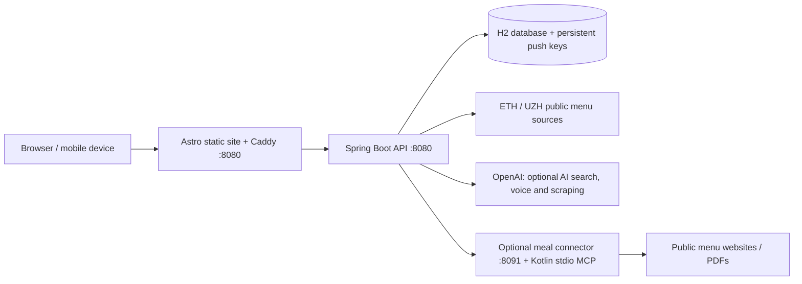

# UniEats / VISard-Lizards

### What’s for Lunch?
The ultimate campus meal finder for ETH Zurich, UZH, and nearby cafeterias—built during **VISCon Hackathon 2026**.

Stop guessing daily menus or standing in surprise 30-minute lines. Browse real-time menus, filter by price or dietary preference, and plan your campus lunch break in seconds.

---

### Core Features

* 📍 **Canteen Locations:** Find cafeteria addresses and sort nearby canteens by distance.
* 🥗 **Menus & Filters:** Instant access to daily cafeteria menus across ETH and UZH, complete with prices and dietary tags (vegan, vegetarian, allergens).
* 📊 **Crowd Reports & Ratings:** See live crowd levels reported by fellow students and rate dishes to help others find the best meal on campus.
* ⭐ **Personalized Dining:** Save dietary preferences and star your favorite dishes to get notified when they're back on the menu.
* 🧭 **First-Time Guided Tour:** Quick onboarding to get new students up and running instantly.

---

### Experimental AI Features (Beta)

* 🎙️ **Voice Assistant:** Hands-free meal search powered by speech. Just ask what’s cooking.

Settings → **Disable beta features** hides only the AI voice-search button on this device; turning it off restores it. Ordinary browsing and typed search remain available independently.

*Note: AI features are completely optional. Typed search, filtering and browsing bundled or already loaded menus do not require an API key. Live menus and feedback require a reachable API.*

---

### Tech Stack & Architecture

A full-stack repository including:
* **Web Frontend**
* **REST API**
* **Kotlin Menu Scraper MCP Service**

> **AI Configuration:** The core app works independently of AI. Configuring an OpenAI API key on the backend enables optional AI search and voice features. Live menu updates and AI requests require an active network connection.

## Architecture



| Directory / configuration | Responsibility |
| --- | --- |
| `frontend/` | Astro 7, TypeScript and Tailwind site; client interactions, first-visit welcome tour, preferences, ratings, crowd display, typed menu search, AI voice assistant (Beta), canteen locations/distance sorting and Web Push UI. |
| `backend/` | Java 25 / Spring Boot 4.1.1 REST API; JPA/H2 persistence, seed import, live menus, ratings, crowd reports, search, recipes, push and MCP orchestration. |
| `meal-scraper/` | Shared Kotlin HTML/PDF extraction library, `server` stdio MCP and `connector` HTTP bridge. Uses the checked-in Kotlin/Amper wrapper, not Gradle. |
| `docker-compose.yml` | Database-volume initialization, Java backend, frontend and optional meal-scraper profile. |
| `render.yaml` | Alternative Render API + static-site Blueprint; without the optional meal scraper. |

API references: [backend/API.md](backend/API.md), [backend/MENSA_API.md](backend/MENSA_API.md), `/swagger-ui.html` and `/v3/api-docs`. See [DEPLOY.md](DEPLOY.md) and [meal-scraper/README.md](meal-scraper/README.md) for detailed subsystem notes. Some older instructions there describe earlier deployment behavior; the caveats below reflect the current configuration.

### Data and rendering

- The API imports the bundled cafeteria/meal snapshot on an empty database, registers new cafeterias on later starts, and preserves existing meal data where appropriate. Live ETH imports run on startup and every six hours in Europe/Zurich for the current and next week. The separate public-page UZH importer runs on startup. Optional AI/MCP scraping runs daily at 06:00 Europe/Zurich and on cache misses/manual refreshes when enabled and configured.
- Onboarding canteen ratings are submitted before completion; accepted submissions are tracked on the device to avoid resending unchanged answers. Failed submissions keep the onboarding draft available for retry. Meal ratings also contribute to the canteen's weighted average, and undo removes that contribution. Homepage/detail stars refresh from the API on load, every two minutes, after feedback and when returning to the tab; no static rebuild is needed. Crowd badges consume recent user reports while open, and the detail chart switches from labelled preview data to backend estimates after ten reports.
- H2 stores meals, ratings, crowd reports, subscriptions and raw scraper evidence. In Compose, `/app/data` is the `backend-data` volume, including generated VAPID keys.
- Astro produces static pages; browser API features use the live backend. `astro dev` renders pages on request; production pages and generated dated links remain snapshots until another build.
- The frontend image builds once during image creation, then its entrypoint waits for the API and **builds again at container startup** using `SERVER_API_URL=http://backend:8080`, copying the generated files into Caddy's `/srv`. Recreating/restarting the frontend triggers this startup build; menu imports alone do not regenerate HTML.
- Without a configured/reachable API, Astro's data loader can render bundled samples. These must not be mistaken for live menus.

## Quick start: Docker Compose

Requirements: Docker Engine/Desktop, a current Docker Compose plugin and internet access for image builds and live menu sources. Host Java and Node are not needed for container builds.

From the repository root, start the basic app without the optional AI meal scraper:

```sh
docker compose up --build -d
```

Open **http://localhost:8080/**. The base stack contains `backend-data-init`, `backend` and `frontend`; the optional `meal-scraper` service is enabled by its profile. Only the frontend publishes a host port; the backend and meal connector remain private to Compose. If 8080 is occupied:

```sh
WEB_PORT=8083 docker compose up --build -d
```

To configure integrations, copy the root example and edit the ignored file locally:

```sh
cp .env.example .env
openssl rand -hex 32
```

Use a generated value for `MEAL_CONNECTOR_TOKEN`. `.env.example` sets `MEAL_SCRAPER_ENABLED=true`, although Compose's unset default is `false`: set it to `false` unless deliberately enabling the scraper. Empty token values in these examples fall back to Compose's development defaults; replace them for a real deployment.

For automatic AI/MCP meal retrieval, configure `OPENAI_API_KEY`, `MEAL_SCRAPER_ENABLED=true`, and the shared meal token, then include the scraper profile:

```sh
docker compose --profile scraper up --build -d
```

Alternatively, set `COMPOSE_PROFILES=scraper` in root `.env`. A server OpenAI key is not needed by the connector itself. Start the scraper profile only when its extraction/AI features are wanted.

Check the stack:

```sh
docker compose config --quiet
docker compose ps
curl -fsS http://localhost:8080/api/health
curl -fsS http://localhost:8080/api/meta
docker compose logs --tail=100 frontend backend
```

Change the curl port if `WEB_PORT` differs. API health alone does not prove that live menus or the optional scraper are ready. Inspect relevant logs and verify menu retrieval; when enabled, inspect `docker compose logs --tail=100 meal-scraper` as well.

Stop without removing persisted data:

```sh
docker compose down
```

**Do not use `docker compose down -v` for routine updates:** it deletes the database volume and persisted push keys. Back up `backend-data` before migrations, host replacement or destructive changes; retain its VAPID key file or existing push subscriptions will become invalid.

## Required versus optional integrations

| Feature / dependency | Requirement and configuration |
| --- | --- |
| Basic menu UI, ratings, crowd reports | No paid API key. Seed/sample data is bundled; live updates require reachable public menu sources. |
| Optional AI backend features, including AI voice assistant (Beta) | Server `OPENAI_API_KEY`; `OPENAI_MODEL` defaults to `gpt-4.1-mini`. Backend also has `OPENAI_REALTIME_MODEL` and `OPENAI_EMBEDDING_MODEL` settings. Plain frontend text filtering remains available without AI; not every AI feature has an offline equivalent. |
| Automatic AI meal refresh | Optional `scraper` profile plus `MEAL_SCRAPER_ENABLED=true`, server OpenAI key and `MEAL_CONNECTOR_TOKEN`. Manual HTTP refresh requires a token of at least 32 characters. `MEAL_SCRAPER_MODEL` defaults to `gpt-6-astra`; `MEAL_SCRAPER_CRON` defaults to `0 0 6 * * *`. |
| Raw maintained ZFV upstream API | Optional `MENSA_ZFV_API_KEY` for the backend ZFV client. Not required for the public-page UZH importer or the basic app. Base Compose does not forward this variable. |
| Web Push | Enabled in backend by default; requires browser support, permission and a secure context (HTTPS or localhost). VAPID keys are generated into `./data/vapid-keys.properties` unless supplied through `VAPID_PUBLIC_KEY` / `VAPID_PRIVATE_KEY`. Configure a real `PUSH_SUBJECT` contact. `PUSH_ENABLED`, `PUSH_CRON` and `VAPID_KEY_FILE` are backend options; daily notifications default to 09:30 Europe/Zurich. |

Model availability and charges depend on the OpenAI account. Override model names if the configured defaults are unavailable; existing environment overrides take precedence over code defaults.

**Configuration boundary:** Compose reads root `.env` for interpolation, but containers receive only variables explicitly declared in their service configuration. Backend-only options absent from `docker-compose.yml` (for example push overrides or `MENSA_ZFV_API_KEY`) need an explicit service `environment` entry/override or another deployment configuration. Running Java directly does not automatically load root `.env`. Never put server keys or connector tokens in `PUBLIC_*` frontend variables or commit real environment files.

Use HTTPS and avoid request/header logging containing credentials.

## Local development without Docker for the UI/API

Requirements: **JDK 25**, **Node 22.13.0 or newer**, and **pnpm 11.25.0** (pinned in `frontend/package.json`). Maven is provided by `backend/mvnw`; the Kotlin wrapper provisions its pinned build tool. Install dependencies on the OS where they will run rather than reusing `node_modules` across Windows/WSL/macOS.

Start the API in one terminal:

```sh
cd backend
sh ./mvnw spring-boot:run
```

Start Astro in a second terminal:

```sh
cd frontend
pnpm install --frozen-lockfile
pnpm dev
```

API: **http://localhost:8080**. UI: **http://localhost:4321**. Astro proxies browser `/api` requests to `http://localhost:8080`; build-time requests also default there. H2 data is written beneath `backend/data/`. Set backend environment variables explicitly before launching Java if enabling integrations.

`frontend/.env.example` documents frontend overrides:

- Leave `PUBLIC_API_URL` unset for same-origin browser requests and default local build-time API access.
- Set `PUBLIC_API_URL=https://your-api.example` for a separate API; configure its CORS origins accordingly.
- Explicit `PUBLIC_API_URL=` means sample-only rendering/no configured API.
- For Astro against a Docker frontend on another port, set `DEV_API_PROXY_URL=http://127.0.0.1:8083` in ignored `frontend/.env.local` (adjust the port). `astro.config.mjs` loads that file for the dev proxy.
- `SERVER_API_URL` is a server/build-time override, not a browser API URL.

These two dev servers alone do **not** start the optional meal connector. For MCP scraping, launch it separately or use the Compose scraper profile. A direct Java backend defaults to `MEAL_CONNECTOR_URL=http://127.0.0.1:8091`, whereas Compose uses `http://meal-scraper:8091`.

Standalone meal connector development (JDK 25, from `meal-scraper/`):

```sh
sh ./kotlin package -m server -m connector -p jvm -f executable-jar
java -jar build/tasks/_connector_executableJarJvm/connector-jvm-executable.jar
```

It defaults to `127.0.0.1:8091` and launches its packaged stdio MCP child. Set the same `MEAL_CONNECTOR_TOKEN` in the connector and backend. No separate scraper repository checkout or OpenAI key in the connector is needed. See its README for extraction-date semantics and smoke testing.

## Deployment

### Linux VM / hackathon host (complete stack)

Configure ignored root `.env`, a unique meal connector token and optional keys, then use the Compose quick-start command (add `--profile scraper` only if needed). On the managed hackathon VM keep `WEB_PORT=8080`, because its ingress forwards that port and supplies TLS/access control. Elsewhere, provide an HTTPS reverse proxy/domain and suitable firewall rules yourself. Mobile devices use the server's address, not their own `localhost`.

Caddy serves HTTP on port 8080, proxies `/api/*`, `/swagger-ui*` and `/v3/api-docs*` to the private backend, limits bodies to 2 MB and sets security headers. `CADDY_TRUSTED_PROXY_RANGES` defaults to `private_ranges`; replace it with known ingress CIDRs if necessary. Do not trust every address: forwarded IPs affect client rate limits.

`INTERNAL_API_ENABLED` defaults to `false`; keep generic CRUD, cache-management and manual import routes disabled on public deployments unless separately protected. Manual AI scraper refresh is separately Bearer-token protected; the short demo connector token cannot authorize it. The accepted response starts a background batch, not a promise that every venue will succeed. `/api/scraped-menus` exposes progress/results. See the PowerShell helper and console workflows in `DEPLOY.md`.

Updates: run the chosen `docker compose ... up --build -d` command again, preserving volumes. The database-volume initialization must complete before the backend starts. Allow startup/import time and verify health and actual menu calls rather than relying only on container startup ordering.

**Frontend startup fallback:** the image pre-populates `/srv` with bundled pages. If backend readiness or the startup build fails, Caddy serves those pages instead of an empty site. Inspect startup logs and restore API readiness before relying on live menus; browser API features still require a healthy backend.

**AI voice assistant (Beta):** Caddy permits microphone access for this site only (`microphone=(self)`). HTTPS (or localhost), browser support and explicit user permission are still required.

### Render Blueprint (API + static site only)

Apply `render.yaml` manually in a Render account; adding the file to GitHub does not provision services. It targets branch `main`, a Docker backend in Frankfurt, and a static frontend. Auto-deploy is configured for passing checks.

The frontend installs pnpm 11.25.0, performs a frozen install, waits up to five minutes for `/api/meta`, then builds `dist`. It uses `PUBLIC_API_URL=https://visard-lizards-api.onrender.com`. If Render assigns different service hostnames, update that URL and API `APP_CORS_ALLOWED_ORIGINS`, then redeploy.

Important limitations of the checked-in Blueprint:

- It does not provision the optional meal scraper or its connector URL/token. MCP scraping requires separate infrastructure and backend configuration.
- The backend is free-plan with no persistent disk configured. H2 data and generated VAPID keys can disappear on restart/redeploy; ratings, crowd reports and subscriptions are not durable. Sleeping services can delay browser calls and builds.
- The frontend uses Node **22.13.0**, matching its declared minimum; use that version or a newer compatible release for local builds.
- Static HTML and dated routes only refresh on frontend rebuild. The readiness check fails the build when the API remains unreachable, but `/api/meta` readiness alone does not prove live menus have fully imported.
- Paid keys, optional integrations, production push contact, durable storage and public-origin settings require explicit deployment configuration; they are not supplied by this Blueprint.

## Tests and builds

Run from the repository root (dependencies for the JS packages must be installed first):

```sh
# Java API tests: wrapper uses JDK 25; Spring tests use in-memory H2.
(cd backend && sh ./mvnw -B test)

# Frontend unit tests, Astro/TypeScript checks and static build.
(cd frontend && pnpm install --frozen-lockfile && pnpm test && pnpm check && PUBLIC_API_URL= pnpm build)

# Kotlin menu extraction and connector/server tests.
(cd meal-scraper && sh ./kotlin test -p jvm)

# Validate service configuration without starting containers.
docker compose config --quiet
```

`PUBLIC_API_URL=` makes the validation build independent of an API and uses bundled samples; omit it when generating live-data pages. Production builds: `(cd backend && sh ./mvnw -B package)` and `(cd frontend && pnpm build)`; `pnpm preview` serves the frontend output locally, not the production Caddy API proxy.

After packaging the Kotlin server/connector, `(cd meal-scraper && python3 scripts/smoke.py)` verifies real stdio/HTTP round trips; `--live` additionally fetches a real menu and depends on the upstream website. It is separate from the deterministic unit tests.

`.github/workflows/ci.yml` runs backend tests, Kotlin connector/server tests, frontend tests/check/build and a Linux Docker MCP/frontend integration smoke check on main pushes and pull requests. The smoke job initializes its database volume and exercises the backend, frontend and meal scraper. Unit tests do not establish that live menu sources, paid accounts or production deployment work.

## Source provenance

The meal scraper was imported from `NikitaSosnovski/hackathon-mensamcp` at the commit recorded in [meal-scraper/README.md](meal-scraper/README.md). Upstream cafeteria identifier catalogs and their licensing are documented in [backend/src/main/resources/mensa/README.md](backend/src/main/resources/mensa/README.md); preserve the notices in `backend/third-party/`. Public menu sources remain subject to their respective terms and attribution requirements.
