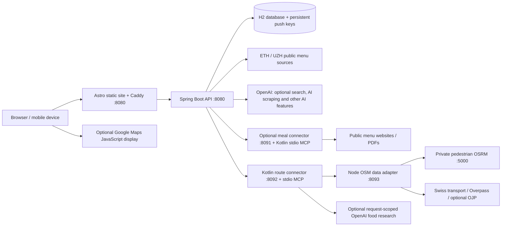

# UniEats / VISard-Lizards

A university meal finder for ETH, UZH and nearby cafeterias, built during the VISCon Hackathon 2026. Browse dated menus, prices and dietary information; rate meals, report crowd levels, and save preferences and starred dishes. A first-visit welcome tour introduces the app. The **AI voice assistant (Beta)** supports spoken meal searches, and the **meal route planner (Beta)** plans walking/public-transport journeys with a meal break. These experimental features depend on browser permissions and available services; ordinary browsing and typed text filtering remain available independently.

The repository contains the website, API, Kotlin MCP services and routing infrastructure. **OpenAI is optional for the basic application. The backend API supports verified routing without AI, but the current route-planner form requires the user's OpenAI key.** Live menus and route providers still require network access; bundled sample menus are not a guarantee of current availability.

## Architecture



| Directory / configuration | Responsibility |
| --- | --- |
| `frontend/` | Astro 7, TypeScript and Tailwind site; client interactions, first-visit welcome tour, preferences, ratings, crowd display, AI voice assistant (Beta), meal route planner (Beta) and Web Push UI. |
| `backend/` | Java 25 / Spring Boot 4.1.1 REST API; JPA/H2 persistence, seed import, live menus, ratings, crowd reports, search, recipes, push and MCP orchestration. |
| `meal-scraper/` | Shared Kotlin HTML/PDF extraction library, `server` stdio MCP and `connector` HTTP bridge; separate `route-server` MCP/HTTP bridge. Uses the checked-in Kotlin/Amper wrapper, not Gradle. |
| `meal-scraper/osm-data/` | Node adapter using `osm-api`, `opening_hours` and XML parsing; cached regional OSM catalog, timetable lookup, walking matrices and transit geometry. |
| `docker-compose.yml` | Main stack, including routing, OSRM download/preprocessing, storage and an optional meal-scraper profile. |
| `compose.route-planner.yaml` | Isolated preview overlay: port 8084, scraper service included, automatic AI meal scraping disabled. |
| `compose.osrm.yaml` | Historical OSRM overlay; private pedestrian OSRM is already in the main stack. |
| `render.yaml` | Alternative Render API + static-site Blueprint; **not** the complete Compose routing stack. |

API references: [backend/API.md](backend/API.md), [backend/MENSA_API.md](backend/MENSA_API.md), `/swagger-ui.html` and `/v3/api-docs`. See [DEPLOY.md](DEPLOY.md), [ROUTE_PLANNER.md](ROUTE_PLANNER.md) and [meal-scraper/README.md](meal-scraper/README.md) for detailed subsystem notes. Some older instructions there describe earlier deployment behavior; the caveats below reflect the current configuration.

### Data and rendering

- The API imports the bundled cafeteria/meal snapshot on an empty database, registers new cafeterias on later starts, and preserves existing meal data where appropriate. Live ETH imports run on startup and every six hours in Europe/Zurich for the current and next week. The separate public-page UZH importer runs on startup. Optional AI/MCP scraping runs daily at 06:00 Europe/Zurich and on cache misses/manual refreshes when enabled and configured.
- Onboarding canteen ratings are submitted before completion; accepted submissions are tracked on the device to avoid resending unchanged answers. Failed submissions keep the onboarding draft available for retry. Meal ratings also contribute to the canteen's weighted average, and undo removes that contribution. Homepage/detail stars refresh from the API on load, every two minutes, after feedback and when returning to the tab; no static rebuild is needed. Crowd badges consume recent user reports while open, and the detail chart switches from labelled preview data to backend estimates after ten reports.
- H2 stores meals, ratings, crowd reports, subscriptions and raw scraper evidence. In Compose, `/app/data` is the `backend-data` volume, including generated VAPID keys.
- Astro produces static pages; browser API features use the live backend. `astro dev` renders pages on request; production pages and generated dated links remain snapshots until another build.
- The frontend image builds once during image creation, then its entrypoint waits for the API and **builds again at container startup** using `SERVER_API_URL=http://backend:8080`, copying the generated files into Caddy's `/srv`. Recreating/restarting the frontend triggers this startup build; menu imports alone do not regenerate HTML.
- Without a configured/reachable API, Astro's data loader can render bundled samples. These must not be mistaken for live menus.

## Quick start: Docker Compose

Requirements: Docker Engine/Desktop, a current Docker Compose plugin, internet access, and enough disk/RAM to download and preprocess a Switzerland pedestrian graph. Host Java and Node are not needed for container builds. OSRM preparation can take several minutes or longer on the first start; subsequent starts reuse its named volume.

From the repository root, start the basic app with routing and without the optional AI meal scraper:

```sh
docker compose up --build -d
```

Open **http://localhost:8080/** and **http://localhost:8080/route-planner/**. By default, only the frontend publishes a host port; the backend, MCP services, adapter and OSRM are private to Compose. If 8080 is occupied:

```sh
WEB_PORT=8083 docker compose up --build -d
```

To configure integrations, copy the root example and edit the ignored file locally:

```sh
cp .env.example .env
openssl rand -hex 32
```

Use a generated value for `MEAL_CONNECTOR_TOKEN`, and a separate generated value for `ROUTE_CONNECTOR_TOKEN`. Add desired routing settings from `.env.route-planner.example` to the **same** root `.env`; do not replace the main example accidentally. `.env.example` sets `MEAL_SCRAPER_ENABLED=true`, although Compose's unset default is `false`: set it to `false` unless deliberately enabling the scraper. Empty token values in these examples fall back to Compose's development defaults; replace them for a real deployment.

For automatic AI/MCP meal retrieval, configure `OPENAI_API_KEY`, `MEAL_SCRAPER_ENABLED=true`, and the shared meal token, then include the scraper profile:

```sh
docker compose --profile scraper up --build -d
```

Alternatively, set `COMPOSE_PROFILES=scraper` in root `.env`. A server OpenAI key is not needed by the connector itself. Start the scraper profile only when its extraction/AI features are wanted; the main route cards use the routing MCP's food research, not this optional connector.

Check the stack:

```sh
docker compose config --quiet
docker compose ps
curl -fsS http://localhost:8080/api/health
curl -fsS http://localhost:8080/api/meta
curl -fsS http://localhost:8080/api/route-planner/status
docker compose logs --tail=100 frontend backend route-planner osm-data osrm-build
```

Change the curl port if `WEB_PORT` differs. API health alone does not prove that the OSRM graph, optional scraper or external providers are ready. Inspect relevant logs and perform a route request after graph preparation.

Stop without removing persisted data:

```sh
docker compose down
```

**Do not use `docker compose down -v` for routine updates:** it deletes the database, catalog and graph volumes. Back up `backend-data` before migrations, host replacement or destructive changes; retain its VAPID key file or existing push subscriptions will become invalid.

## Required versus optional integrations

| Feature / dependency | Requirement and configuration |
| --- | --- |
| Basic menu UI, ratings, crowd reports | No paid API key. Seed/sample data is bundled; live updates require reachable public menu sources. |
| Verified walking/transit meal routes (backend API) | Private foot-profile OSRM, adapter, route MCP and Swiss transport/OSM providers. All are wired by the base Compose stack. The API can verify routes without OpenAI; the current browser route form requires a user OpenAI key. No Google routing key is required. |
| Route service authentication | `ROUTE_CONNECTOR_TOKEN`: shared by backend, route connector and adapter; route connector requires at least 16 characters. Compose has a local development default; use a unique long secret in deployment. |
| Optional AI backend features, including AI voice assistant (Beta) | Server `OPENAI_API_KEY`; `OPENAI_MODEL` defaults to `gpt-4.1-mini`. Backend also has `OPENAI_REALTIME_MODEL` and `OPENAI_EMBEDDING_MODEL` settings. Plain frontend text filtering remains available without AI; not every AI feature has an offline equivalent. |
| Automatic AI meal refresh | Optional `scraper` profile plus `MEAL_SCRAPER_ENABLED=true`, server OpenAI key and `MEAL_CONNECTOR_TOKEN`. Manual HTTP refresh requires a token of at least 32 characters. `MEAL_SCRAPER_MODEL` defaults to `gpt-6-astra`; `MEAL_SCRAPER_CRON` defaults to `0 0 6 * * *`. |
| Meal route planner (Beta): AI selection/explanation | The current route form requires the user to enter an OpenAI key in its required password input; the API uses request header `X-OpenAI-Key`. `ROUTE_PLANNER_MODEL` defaults to `gpt-6-astra`. Direct API requests without a key, or AI failures after submission, can return verified backend-ranked routes with a warning when provider evidence is available. The form does not currently offer keyless submission. |
| Route-card food/cuisine research | Routing MCP tool `search_meal_place_food`, using the user's request-scoped key. `FOOD_SEARCH_MODEL` defaults to `gpt-5-mini`; failures/no key fall back to labelled OSM tags. It researches food types, not dated dishes or prices. |
| Map visualization | Optional `GOOGLE_MAPS_BROWSER_KEY` for Maps JavaScript API. It is deliberately public through `/api/route-planner/map-config`: restrict it by API and website referrer. It displays supplied geometry; Google Directions/Routes/Places/geocoding are not used. |
| Service-specific train geometry | Optional `OJP_API_KEY` and `OJP_API_URL` (default Swiss OJP 2.0 endpoint). Key is supplied only to the private adapter. Timetable routes remain usable without it; approximate/unavailable transit geometry is labelled or omitted. |
| Raw maintained ZFV upstream API | Optional `MENSA_ZFV_API_KEY` for the backend ZFV client. Not required for the public-page UZH importer or the basic app. Base Compose does not forward this variable. |
| Web Push | Enabled in backend by default; requires browser support, permission and a secure context (HTTPS or localhost). VAPID keys are generated into `./data/vapid-keys.properties` unless supplied through `VAPID_PUBLIC_KEY` / `VAPID_PRIVATE_KEY`. Configure a real `PUSH_SUBJECT` contact. `PUSH_ENABLED`, `PUSH_CRON` and `VAPID_KEY_FILE` are backend options; daily notifications default to 09:30 Europe/Zurich. |

Model availability and charges depend on the OpenAI account. Override model names if the configured defaults are unavailable; existing environment overrides take precedence over code defaults.

**Configuration boundary:** Compose reads root `.env` for interpolation, but containers receive only variables explicitly declared in their service configuration. Backend-only options absent from `docker-compose.yml` (for example push overrides or `MENSA_ZFV_API_KEY`) need an explicit service `environment` entry/override or another deployment configuration. Running Java directly does not automatically load root `.env`. Never put server keys or connector tokens in `PUBLIC_*` frontend variables or commit real environment files.

Route-selection keys are request-scoped, not stored in the database or browser persistence, and do not go to OSM/map providers. Food research is a distinct path: its user credential is passed privately through the routing connector to the MCP tool that calls OpenAI. Use HTTPS and avoid request/header logging containing credentials.

## Local development without Docker for the UI/API

Requirements: **JDK 25**, **Node 22.13.0 or newer**, and **pnpm 11.25.0** (pinned in `frontend/package.json`). Maven is provided by `backend/mvnw`; the Kotlin wrapper provisions its pinned build tool. Install dependencies on the OS where they will run rather than reusing `node_modules` across Windows/WSL/macOS.

Start the API in one terminal:

```sh
cd backend
sh ./mvnw spring-boot:run
```

Start Astro in a second terminal:

```sh
cd frontend
pnpm install --frozen-lockfile
pnpm dev
```

API: **http://localhost:8080**. UI: **http://localhost:4321**. Astro proxies browser `/api` requests to `http://localhost:8080`; build-time requests also default there. H2 data is written beneath `backend/data/`. Set backend environment variables explicitly before launching Java if enabling integrations.

`frontend/.env.example` documents frontend overrides:

- Leave `PUBLIC_API_URL` unset for same-origin browser requests and default local build-time API access.
- Set `PUBLIC_API_URL=https://your-api.example` for a separate API; configure its CORS origins accordingly.
- Explicit `PUBLIC_API_URL=` means sample-only rendering/no configured API.
- For Astro against a Docker frontend on another port, set `DEV_API_PROXY_URL=http://127.0.0.1:8083` in ignored `frontend/.env.local` (adjust the port). `astro.config.mjs` loads that file for the dev proxy.
- `SERVER_API_URL` is a server/build-time override, not a browser API URL.

These two dev servers alone do **not** start route MCP, the Node adapter or OSRM. Run the Compose routing infrastructure or launch/configure those services separately; a direct Java backend defaults to connector URLs `http://127.0.0.1:8091` and `http://127.0.0.1:8092`, whereas Compose uses service names.

Standalone meal connector development (JDK 25, from `meal-scraper/`):

```sh
sh ./kotlin package -m server -m connector -p jvm -f executable-jar
java -jar build/tasks/_connector_executableJarJvm/connector-jvm-executable.jar
```

It defaults to `127.0.0.1:8091` and launches its packaged stdio MCP child. Set the same `MEAL_CONNECTOR_TOKEN` in the connector and backend. No separate scraper repository checkout or OpenAI key in the connector is needed. See its README for extraction-date semantics and smoke testing.

## Meal route planner (Beta): infrastructure and preview

The main stack automatically downloads `switzerland-latest.osm.pbf` from Geofabrik into `osrm-data`, runs `osrm-extract` with `/opt/foot.lua`, `osrm-partition` and `osrm-customize`, then serves the MLD graph using OSRM v5.27.1. Never substitute a driving graph for walking.

OSRM preparation is skipped when the `foot-ready` marker exists. The extract is downloaded only when absent: graph freshness is **not** maintained automatically. Plan an explicit graph replacement/rebuild when updating OSM data. `OSRM_DATA_VOLUME` can point to an existing prepared graph volume; the normal default is `${COMPOSE_PROJECT_NAME}_osrm-data`.

The adapter persists a regional Zurich food-place catalog in `osm-catalog`; Swiss timetables and Overpass are external shared services with pacing/cooldowns. It uses OSM opening hours and verified travel times, not a guarantee of kitchen operation, menu completeness or prices. Transit still needs the Swiss timetable provider: OSM alone is not a transit engine.

Optional provider overrides: `OSM_FOOT_URL`, `SWISS_TRANSPORT_URL`, `OSM_OVERPASS_URL`, `OSM_TRANSIT_GEOMETRY_URL`, `OJP_API_URL`. Keep a foot-profile routing provider behind any `OSM_FOOT_URL` replacement. No Nominatim or OSM login is required.

For an isolated preview, with current Compose support for `!override` (Compose 2.24.4+):

```sh
docker compose -p mensa-route-test -f docker-compose.yml -f compose.route-planner.yaml up --build -d
```

Open **http://localhost:8084/route-planner/** (`ROUTE_WEB_PORT` can override it). The different project name separates its database/catalog/graph volumes unless `OSRM_DATA_VOLUME` deliberately selects a shared graph. The overlay clears the scraper service's profile and forces automatic AI scraping off. There is no required `route-planner` profile: routing is already in the base file.

`compose.osrm.yaml` is not needed for the normal stack/preview. If used as an additional historical overlay, its preprocessing check expects `region.osm.pbf`; the current base stack already supplies the download job. Prefer the base configuration instead of following old FOSSGIS/manual-loading instructions.

## Deployment

### Linux VM / hackathon host (complete stack)

Configure ignored root `.env`, unique connector secrets and optional keys, then use the Compose quick-start command (add `--profile scraper` only if needed). On the managed hackathon VM keep `WEB_PORT=8080`, because its ingress forwards that port and supplies TLS/access control. Elsewhere, provide an HTTPS reverse proxy/domain and suitable firewall rules yourself. Mobile devices use the server's address, not their own `localhost`.

Caddy serves HTTP on port 8080, proxies `/api/*`, `/swagger-ui*` and `/v3/api-docs*` to the private backend, limits bodies to 2 MB and sets security headers. `CADDY_TRUSTED_PROXY_RANGES` defaults to `private_ranges`; replace it with known ingress CIDRs if necessary. Do not trust every address: forwarded IPs affect client rate limits.

`INTERNAL_API_ENABLED` defaults to `false`; keep generic CRUD, cache-management and manual import routes disabled on public deployments unless separately protected. Manual AI scraper refresh is separately Bearer-token protected; the short demo connector token cannot authorize it. The accepted response starts a background batch, not a promise that every venue will succeed. `/api/scraped-menus` exposes progress/results. See the PowerShell helper and console workflows in `DEPLOY.md`.

Updates: run the chosen `docker compose ... up --build -d` command again, preserving volumes. Container startup ordering is not full dependency health checking: routing services use `service_started`, while graph jobs must complete successfully. Allow startup time and verify actual route/menu calls.

**Frontend startup fallback:** the image pre-populates `/srv` with bundled pages. If backend readiness or the startup build fails, Caddy serves those pages instead of an empty site. Inspect startup logs and restore API readiness before relying on live menus; browser API features still require a healthy backend.

**AI voice assistant (Beta):** Caddy permits microphone access for this site only (`microphone=(self)`). HTTPS (or localhost), browser support and explicit user permission are still required.

### Render Blueprint (API + static site only)

Apply `render.yaml` manually in a Render account; adding the file to GitHub does not provision services. It targets branch `main`, a Docker backend in Frankfurt, and a static frontend. Auto-deploy is configured for passing checks.

The frontend installs pnpm 11.25.0, performs a frozen install, waits up to five minutes for `/api/meta`, then builds `dist`. It uses `PUBLIC_API_URL=https://visard-lizards-api.onrender.com`. If Render assigns different service hostnames, update that URL and API `APP_CORS_ALLOWED_ORIGINS`, then redeploy.

Important limitations of the checked-in Blueprint:

- It does not provision route MCP, the OSM adapter, OSRM, or the meal scraper, nor their connector URLs/secrets. The full route planner/optional scraper require separate infrastructure and backend configuration.
- The backend is free-plan with no persistent disk configured. H2 data and generated VAPID keys can disappear on restart/redeploy; ratings, crowd reports and subscriptions are not durable. Sleeping services can delay browser calls and builds.
- The frontend uses Node **22.13.0**, matching its declared minimum; use that version or a newer compatible release for local builds.
- Static HTML and dated routes only refresh on frontend rebuild. The readiness check fails the build when the API remains unreachable, but `/api/meta` readiness alone does not prove live menus have fully imported.
- Paid keys, optional integrations, production push contact, durable storage and public-origin settings require explicit deployment configuration; they are not supplied by this Blueprint.

## Tests and builds

Run from the repository root (dependencies for the JS packages must be installed first):

```sh
# Java API tests: wrapper uses JDK 25; Spring tests use in-memory H2.
(cd backend && sh ./mvnw -B test)

# Frontend unit tests, Astro/TypeScript checks and static build.
(cd frontend && pnpm install --frozen-lockfile && pnpm test && pnpm check && PUBLIC_API_URL= pnpm build)

# Kotlin extraction, connector and routing tests.
(cd meal-scraper && sh ./kotlin test -p jvm)

# Node adapter tests, including catalog, providers, transit geometry and OJP fixtures.
(cd meal-scraper/osm-data && npm ci && npm test)

# Validate service configuration without starting containers.
docker compose config --quiet
```

`PUBLIC_API_URL=` makes the validation build independent of an API and uses bundled samples; omit it when generating live-data pages. Production builds: `(cd backend && sh ./mvnw -B package)` and `(cd frontend && pnpm build)`; `pnpm preview` serves the frontend output locally, not the production Caddy API proxy.

After packaging the Kotlin server/connector, `(cd meal-scraper && python3 scripts/smoke.py)` verifies real stdio/HTTP round trips; `--live` additionally fetches a real menu and depends on the upstream website. It is separate from the deterministic unit tests.

`.github/workflows/ci.yml` runs backend tests, Kotlin tests, Node adapter tests, frontend tests/check/build and a Linux Docker MCP/frontend integration smoke check on main pushes and pull requests. The smoke job initializes its database volume and starts only the three services it exercises, without downloading the Swiss OSRM graph. Routing requires a separate full-stack deployment check with the prepared graph and reachable providers. Unit tests do not establish that external providers, paid accounts or production deployment work.

## Source provenance

The meal scraper was imported from `NikitaSosnovski/hackathon-mensamcp` at the commit recorded in [meal-scraper/README.md](meal-scraper/README.md). Upstream cafeteria identifier catalogs and their licensing are documented in [backend/src/main/resources/mensa/README.md](backend/src/main/resources/mensa/README.md); preserve the notices in `backend/third-party/`. OSM/provider data and public menu sources remain subject to their respective terms and attribution requirements.
